Link del repositorio: https://github.com/Elimarlli/EMLExamen26ED

1. 
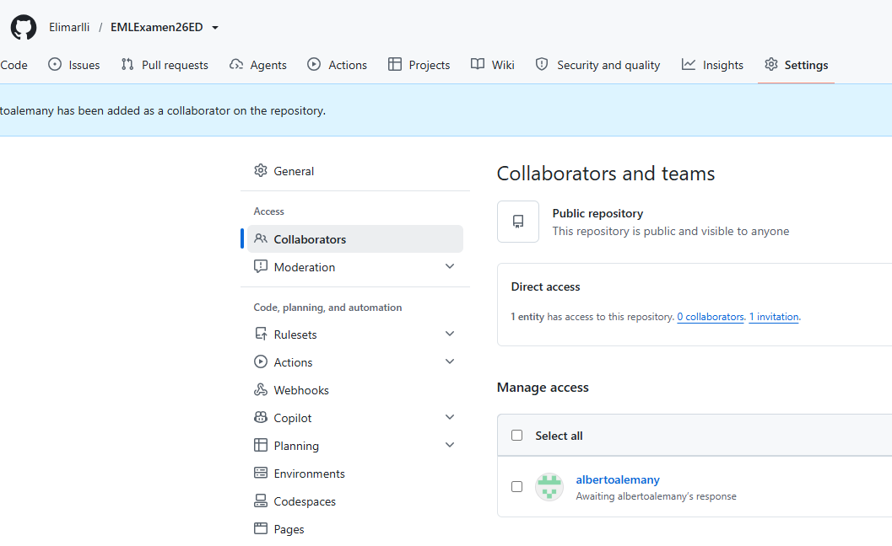

2. 
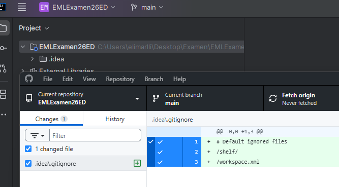

3. 
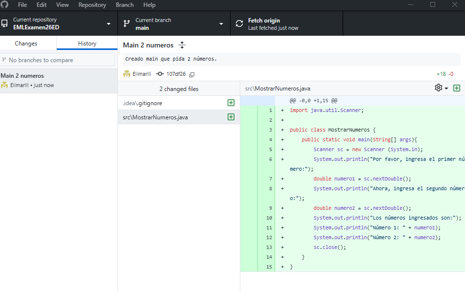

4. 
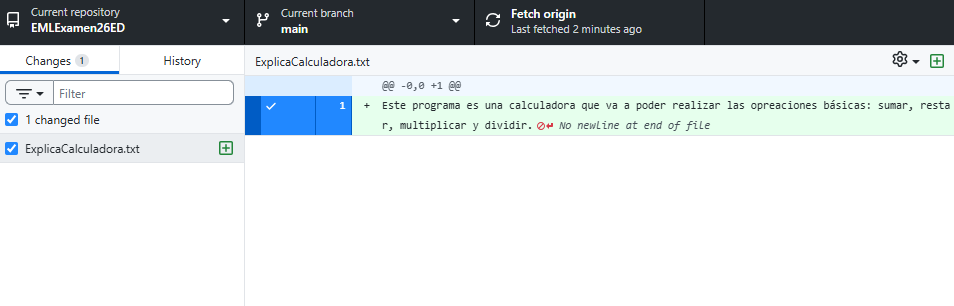

* 4.1 . 
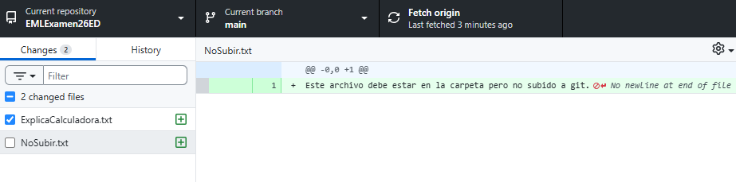

5. 
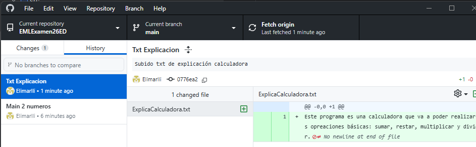

6. 
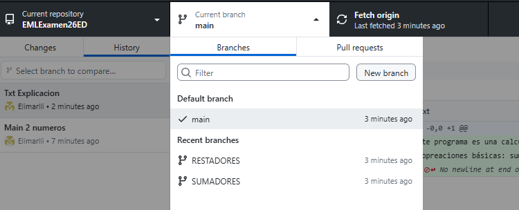

7. 
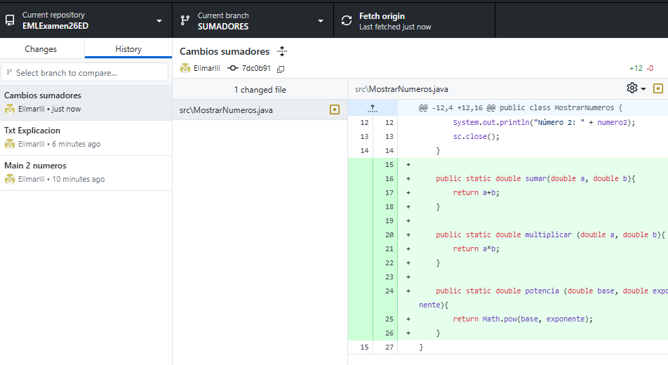

8. 
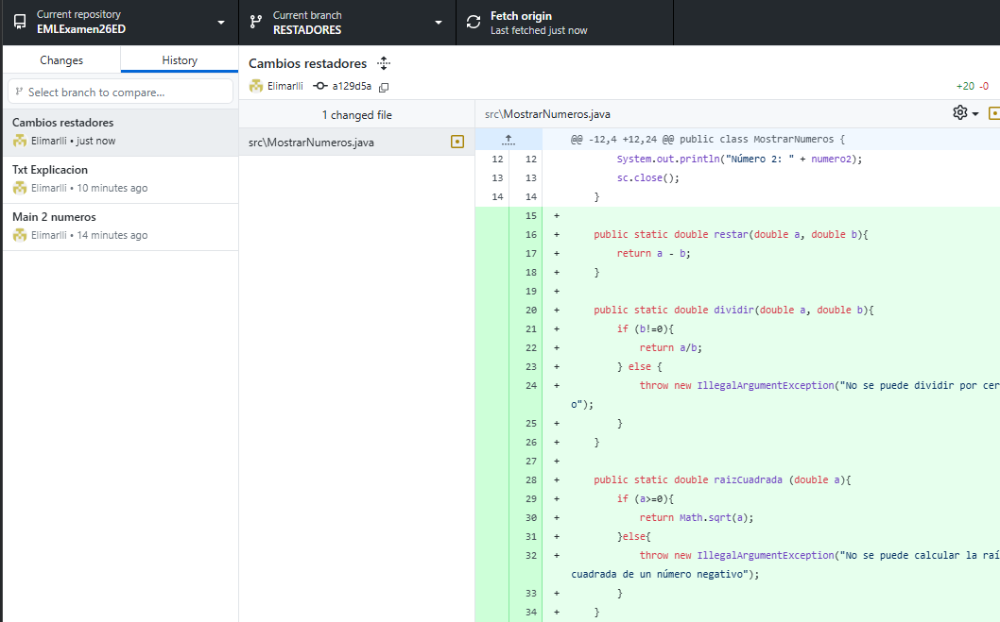

9. 
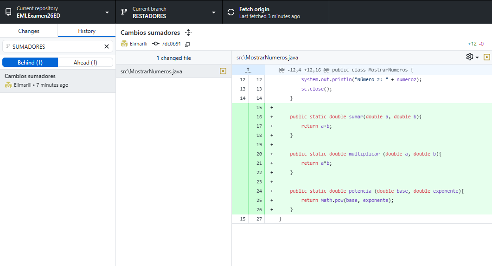
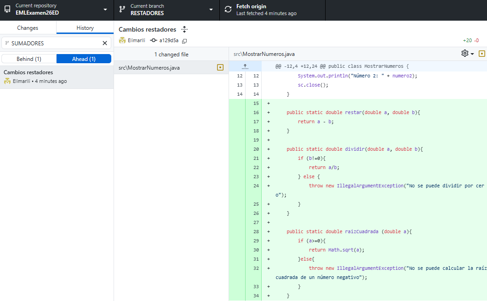

Txt de las diferencias: 

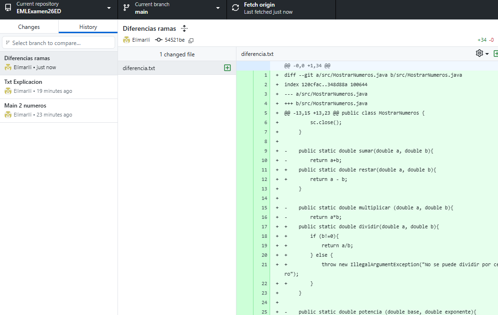

10. 
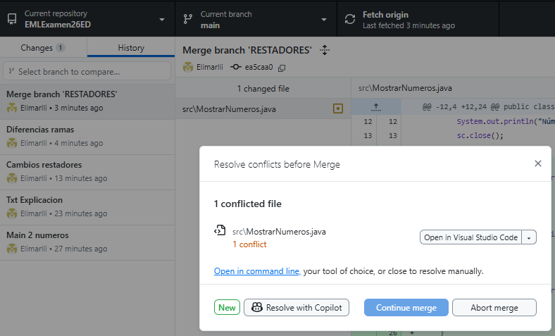

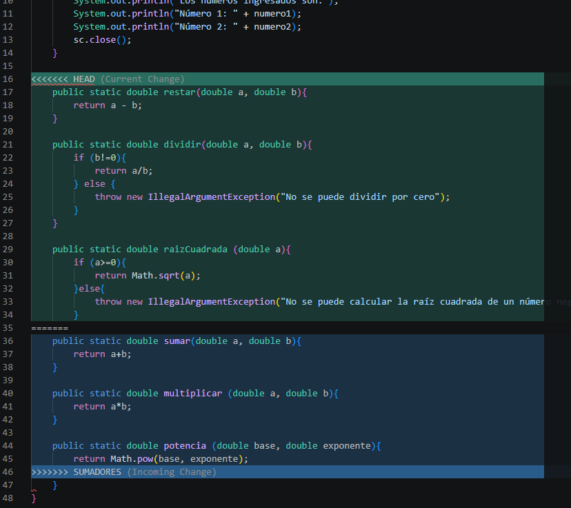

Tras aceptar ambos cambios:

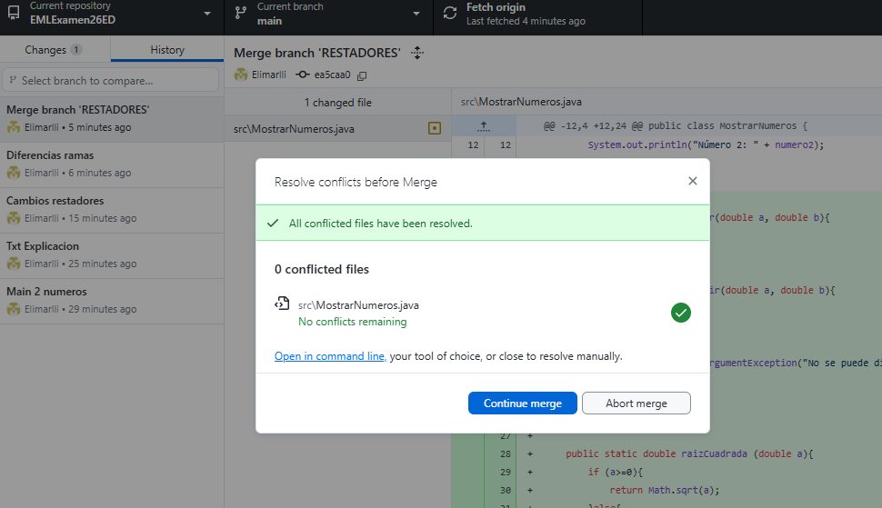

11. 
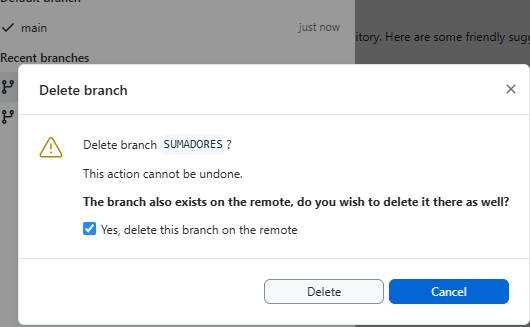

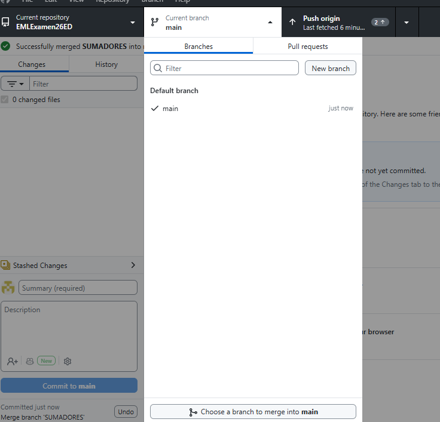

12. 
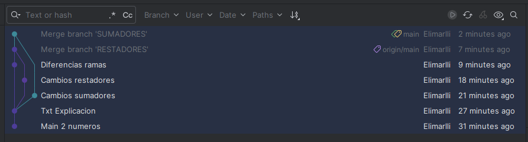

Se observa en tres tonalidades las ramas, la de la izquierda es el Main, otra de sumadores y restadores, de arriba hacia abajo y en lo más actualizado (arriba) como se han unido las ramas creadas al Main.

13. La diferencia es que clonar es traer todo el repositorio, mientras que el pull actualiza con los últimos cambios respecto a lo que tenemos en local.

14. 
He comentado todo el main para que no sea útil:

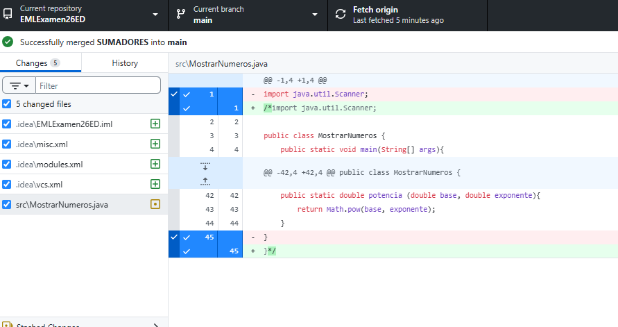

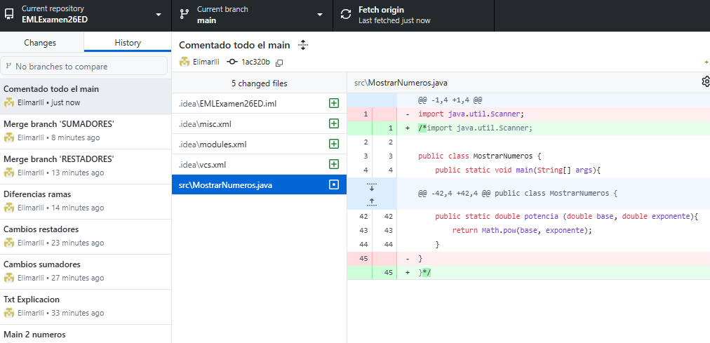

15. 
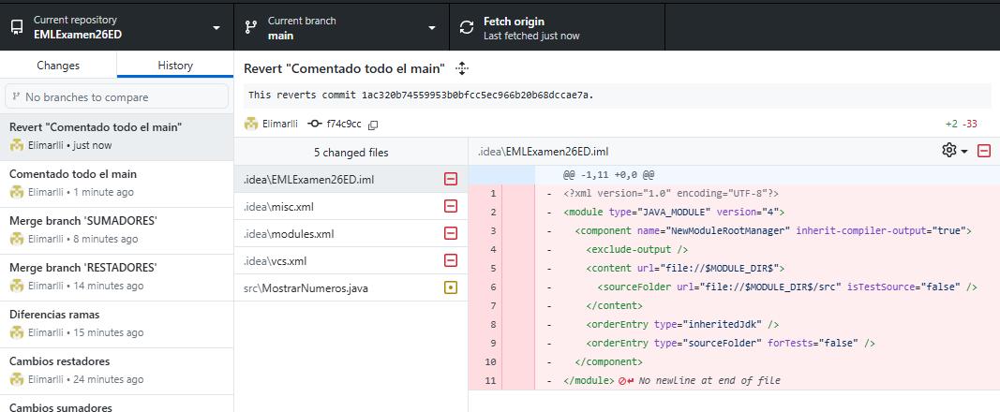

16. 

